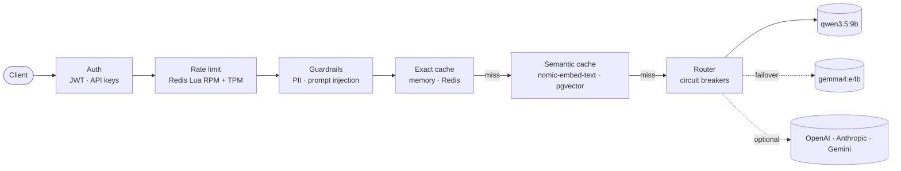

# LLM Gateway, Cache and Guardrails

An OpenAI-compatible **LLM gateway in Go** that sits between your applications and the models. It authenticates tenants, enforces request and token limits, strips private data and blocks prompt-injection attacks, answers repeated and reworded questions from a **pgvector semantic cache**, and fails over between models behind circuit breakers. A **Next.js dashboard** shows it all live.

It runs **entirely on local models with zero paid API keys**: `qwen3.5:9b` answers, `gemma4:e4b` takes over when Qwen fails, and `nomic-embed-text` powers the semantic cache, all through [Ollama](https://ollama.com). OpenAI, Anthropic and Gemini adapters are included for hosted models.

## Results on real models

Measured by `make bench`: 1,000 requests from 4 concurrent clients through local Ollama, with real Redis and pgvector and 10% of model calls failing on purpose ([full results](docs/BENCHMARKS.md)).

| | |
|---|---|
| Answers served from the cache | **53.9%**, of which 39.5% were reworded questions matched by meaning |
| Wrong answers from the semantic cache | **0** of 380 verified |
| Cached answer vs. generating it | **16 ms vs 7.8 s** at p50 (99.79% faster) |
| Average latency across all requests | **54% lower** than without the cache |
| Model failures seen by users | **0** of 39 injected faults: every one was answered by the fallback model |
| PII prompts redacted / injection attempts blocked | **100/100** / **19/19**, with 0 false positives |
| Gateway overhead | 16 ms p50 (mostly the neural embedding); 0.14 ms for exact hits |

Throughput on a laptop is bounded by the model (Ollama generates one answer at a time), not by the gateway: with a fast mock upstream the same gateway handles **1,526 req/s**, and **30,087 req/s** from cache.

## What is verified

- **Against the real models** (`make ollama-check`): chat and streaming through Qwen; failover to Gemma on injected errors and timeouts; the circuit breaker tripping and recovering; reworded questions served from the neural cache while near-misses are not; the gateway staying up when the embedding model is offline.
- **Core logic, under Go's race detector, against real Redis and pgvector:** token and API-key authentication, exact rate limiting under heavy contention, PII and injection detection including look-alike false positives, cache isolation between tenants and embedding models, and database schema migrations.
- **Deployments, in CI on every push:** the full Docker Compose stack end to end, and Kubernetes on a real cluster: Ingress load balancing across replicas, a pod killed under load and a rolling restart with **zero failed requests**, and survival of a Redis outage.
- **Dashboard:** component tests and browser end-to-end tests.

Details: [docs/TESTING.md](docs/TESTING.md).

## How it works



Each request is authenticated, rate-limited by requests and tokens in one atomic Redis step, scanned for private data and attacks, then answered from the exact cache, from the semantic cache, or by a model. Failures fail over to the next model. Everything is measured: Prometheus metrics, an audit log, and a live dashboard. See [docs/ARCHITECTURE.md](docs/ARCHITECTURE.md).

## Quickstart

```bash
make venv            # one-time: Go, Postgres+pgvector, Redis, kubectl in .venv (no system installs)
make ollama-pull     # qwen3.5:9b, gemma4:e4b, nomic-embed-text
make run             # gateway on :8080
make web-dev         # dashboard on :3000 (second terminal)
make ollama-check    # live test through your models
```

```bash
TOKEN=$(curl -s -XPOST localhost:8080/v1/auth/token -d '{"tenant_id":"demo"}' | jq -r .access_token)
curl -s localhost:8080/v1/chat/completions -H "Authorization: Bearer $TOKEN" \
  -d '{"model":"qwen3.5:9b","messages":[{"role":"user","content":"What is the CAP theorem?"}]}'
```

No models? `make run-mock` uses a bundled mock upstream. Docker Compose, Kubernetes and configuration: [docs/OPERATIONS.md](docs/OPERATIONS.md).

## Documentation

| | |
|---|---|
| [Architecture](docs/ARCHITECTURE.md) | request lifecycle, components, headers, design decisions, configuration |
| [Benchmarks](docs/BENCHMARKS.md) | methodology and full results: real models, gateway capacity, k6 |
| [Testing](docs/TESTING.md) | test suites and what each verifies |
| [Operations](docs/OPERATIONS.md) | local setup, Docker Compose, Kubernetes, containers with Ollama |
| [Changelog](CHANGELOG.md) | releases, including every bug found and fixed |

## Repository layout

```text
cmd/            gateway server, mock LLM, benchmark runner
internal/       auth, ratelimit, guardrails, cache, router, telemetry, gateway pipeline, config, storage
migrations/     PostgreSQL + pgvector schema
configs/        gateway.yaml (local Ollama, default) and gateway.mock.yaml
web/            Next.js dashboard
deploy/         Kubernetes (base + local overlay) and Prometheus
benchmarks/     results.json (real models), results-mock.json, k6 script
scripts/        toolchain setup, local services, smoke tests, on-demand Docker runtime
docs/           architecture, benchmarks, testing, operations
```

## Limitations

- Measured on one laptop: the benchmark client, gateway, databases and models share the machine. Throughput with local models is bounded by the GPU.
- Kubernetes is verified on single-node clusters (k3s, kind), not a multi-node cloud cluster.
- Dashboard telemetry is per gateway replica; Prometheus aggregates across replicas.
