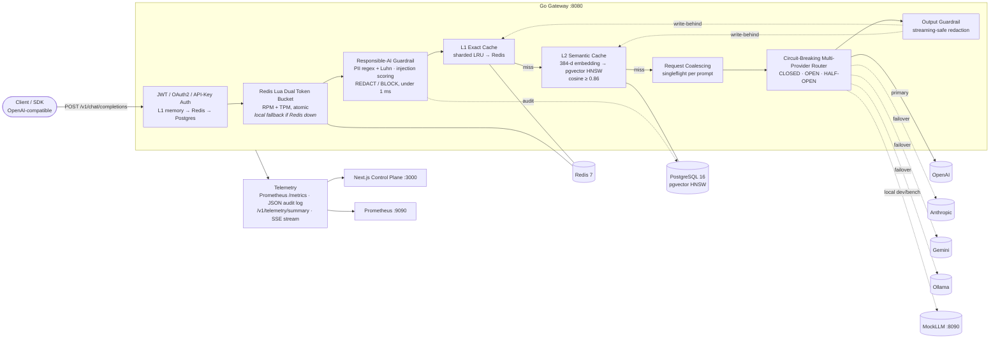

# LLM Gateway, Cache and Guardrails

A high-throughput, cloud-native **LLM semantic gateway** written in Go: an OpenAI-compatible proxy that sits in front of OpenAI, Anthropic, Gemini, and Ollama. It provides:

- multi-tenant auth,
- an atomic Redis dual token-bucket rate limiter (RPM + TPM),
- a sub-millisecond Responsible-AI guardrail firewall (PII redaction and prompt-injection blocking),
- a two-tier exact + **pgvector semantic cache**,
- per-provider **circuit breakers with automatic failover**.

A **Next.js + TypeScript control plane** streams live telemetry and includes an interactive playground.

Every number in this README was **measured** by `cmd/bench` and is stored in [`benchmarks/results.json`](benchmarks/results.json).

---

## Headline results (measured)

Workload: 5,000 requests across 100 concurrent workers, real Redis 7.4 and PostgreSQL 16 + pgvector 0.6, and a 10% injected upstream 503 rate. See [Benchmarks](#benchmarks) for the full table and methodology.

| Metric | Result |
|---|---|
| Mixed-workload throughput | **1,515 req/s** (100 workers, upstream p50 168 ms) |
| Hot-cache throughput | **29,922 req/s** |
| Gateway overhead (all requests) | **p50 0.98 ms · p95 3.29 ms** · p99 23.0 ms |
| Cache hit ratio | **61.85%**: 35.74% exact + 26.10% semantic |
| Semantic-cache precision | **98.75%** (1,276 semantic hits verified against ground truth) |
| Latency reduction on a cache hit | **99.67%** at p50 (0.56 ms vs 170.6 ms) · **61.5%** lower mean end-to-end latency |
| Automatic failover success | **100%**: 162 injected 503s, 0 unrecovered errors |
| Guardrails | 561/561 PII prompts redacted · 112/112 injections blocked · **0 false positives** |
| Guardrail latency | **2.9 µs** p50 typical prompt · **121 µs** p99 for a 3.6 KB PII-laden prompt |

---

## Architecture



### Request lifecycle

1. **Auth** (`internal/auth`): accepts `Authorization: Bearer <JWT>` signed with HS256, RS256 with a static PEM key, or RS256 from an OAuth2/OIDC **JWKS** endpoint (with key rotation by `kid`). It also accepts `X-API-Key`, looked up through **L1 memory → Redis → PostgreSQL**. Keys are stored only as SHA-256 hashes, and unknown keys are negatively cached. The JWT claims `tenant_id`, `tier`, `rpm_limit`, `tpm_limit`, and `pii_mode` define the tenant policy.
2. **Rate limit** (`internal/ratelimit`): one **atomic Lua script** refills and checks *both* buckets using the Redis server clock, and debits them only if **both** have capacity. TPM is charged with an estimate (prompt chars/4 + `max_tokens`) and **reconciled** after the response; cache hits are refunded in full. Bucket keys use `{tenant}` hash tags, so they're safe on Redis Cluster. If Redis errors, a sharded in-process bucket takes over and Redis is retried after a backoff.
3. **Guardrails** (`internal/guardrails`): PII detection uses regexes, **Luhn + IIN** validation for cards, SSN area/group/serial rules, emails, phones, AWS keys, and OpenAI/GitHub/Slack/Google API keys. Matches are redacted (`[REDACTED_SSN]`, …) or blocked (`400 PII_DETECTED`) according to the tenant's mode. The injection firewall combines 11 weighted heuristics with a noisy-OR. They run over leetspeak-folded and spaced-letter-collapsed text, plus delimiter and chat-template tokens, role spoofing, and **base64-encoded payloads**, which are decoded and re-scored. Prompts at or above 0.70 are blocked (`400 PROMPT_INJECTION`).
4. **Cache** (`internal/cache`): the **exact** key is `sha256(tenant, model, normalized conversation)`. The **semantic** lookup embeds the final user turn and searches pgvector, scoped by tenant, model, and a **scope hash** of the system prompt and prior turns, so a paraphrase can only match an identical context. Writes are asynchronous (write-behind), and PII is redacted *before* anything is cached.
5. **Coalescing:** concurrent identical misses share one upstream call through `singleflight`. In tests, 25 concurrent identical requests produced exactly 1 upstream call.
6. **Router** (`internal/router`): adapters translate OpenAI ⇄ Anthropic Messages ⇄ Gemini `generateContent`, for both JSON and SSE. A `5xx`, `429`, timeout, or transport error fails over to the next target; other `4xx` errors don't and never trip the breaker. Streams fail over before the first byte is relayed.
7. **Output guardrails:** JSON responses are redacted directly. Streams go through a holdback-window redactor that catches PII split across chunk boundaries, with tests at 1-, 3-, 7-, 16-, and 64-byte chunk sizes.

### Response headers

| Header | Meaning |
|---|---|
| `X-Gateway-Cache` | `HIT-EXACT` · `HIT-SEMANTIC` · `MISS` · `BYPASS` |
| `X-Gateway-Cache-Similarity`, `X-Gateway-Cache-Layer` | cosine score; `memory` / `redis` / `pgvector` |
| `X-Gateway-Provider`, `X-Gateway-Provider-Failover` | serving provider; `true` if a fallback served the request |
| `X-Gateway-Overhead-Ms`, `X-Gateway-Upstream-Latency-Ms`, `X-Gateway-Total-Latency-Ms` | latency breakdown |
| `X-Gateway-Guardrail`, `X-Gateway-Guardrail-Categories` | `REDACT` / `BLOCK` / `FLAG`; e.g. `CREDIT_CARD,SSN` |
| `X-RateLimit-Limit-Requests`, `X-RateLimit-Remaining-Requests`, `X-RateLimit-Limit-Tokens`, `X-RateLimit-Remaining-Tokens`, `X-RateLimit-Reset`, `Retry-After` | standard quota headers (429 on exhaustion) |
| `X-Gateway-Tokens-Saved`, `X-Gateway-Coalesced`, `X-Request-ID` | savings, coalescing, tracing |

---

## Key design decisions

- **Rate-based circuit breaking in admission order.** The first benchmark run exposed a real bug. Injected 503s return instantly while successes take about 170 ms, so at 100 concurrent workers the first ~10 *completions* were all failures. Both a "5 consecutive failures" rule and a naive sliding window tripped the breaker at a true error rate of only 10%. The breaker now feeds outcomes into its window **in admission order**: a result counts only once every earlier-admitted call has resolved. It trips when ≥50% of the last 20 calls failed, with a minimum of 10 calls. Regression test: `TestBreakerNoFalseTripOnFastFailures`.
- **Pre-warmed connection pool.** Profiling showed the miss path's p95 tail (~47 ms) came from the pool opening connections lazily, with type registration, during bursts. A warmed `min_conns` pool cut the miss-lookup p95 from 47 ms to 4.6 ms. Semantic hit counters are batched into one `UPDATE … FROM unnest()` every 2 s to avoid hot-row lock contention.
- **Deterministic local embedder behind an `Embedder` interface.** It uses signed feature hashing of stemmed, synonym-canonicalized unigrams, bigrams, and character trigrams into 384 dimensions (2 µs per prompt), so benchmarks need no external API. It captures *lexical* paraphrases such as reordering, contractions, filler words, and common synonyms, not deep semantics. For production, set `cache.embedder: openai` (an OpenAI-compatible `/v1/embeddings` endpoint called with `dimensions=384`); the pgvector schema stays the same. Precision is **measured** rather than assumed: the mock echoes the prompt it answered, so the benchmark verifies every semantic hit against ground truth.
- **Fail open on infrastructure, fail closed on policy.** If Redis or Postgres is down, the gateway degrades to local rate limiting and an in-memory cache and key store rather than going offline. Guardrails never fail open.
- **Overhead is measured, not estimated.** The gateway reports total time minus upstream time per request. Coalesced followers subtract their actual wait.

---

## Benchmarks

`make bench` runs `cmd/bench`, which starts **mockllm and the gateway in-process on real loopback TCP ports**. It connects to the real **Redis 7.4** and **PostgreSQL 16 + pgvector 0.6** from `.venv`, runs four phases, and writes `benchmarks/results.json`.

**Environment:** Apple Silicon arm64, 15 CPUs, macOS, Go 1.27.2. The load generator, gateway, mock upstream, Redis, and Postgres all share one machine, which inflates tail latency.
**Mock upstream:** TTFT 120 ms ±15% jitter, 1 ms per token, 48 tokens, giving a realistic ~168 ms uncached latency.
**Workload:** 300 head intents (60 topics × 5 question types) × 4 human-style paraphrases, chosen by **zipf (s = 1.1)**, plus 25% never-repeating long-tail prompts, 10% PII prompts, 2% prompt-injection attempts, and a **10% injected 503 rate** on the primary provider (OpenAI-format), failing over to Anthropic, then Gemini.

### Results (`benchmarks/results.json`)

| Phase / metric | p50 | p95 | p99 | Notes |
|---|---:|---:|---:|---|
| **Uncached upstream baseline** (direct to mock, 500 req) | 168.15 ms | 184.75 ms | 186.72 ms | no gateway |
| **Gateway overhead**, all 4,888 successful requests | **0.979 ms** | **3.294 ms** | 23.018 ms | mean 1.50 ms |
| Gateway overhead, cache hits (3,023) | 0.251 ms | 2.835 ms | 3.637 ms | |
| Gateway overhead, cache misses (1,865) | 1.325 ms | 16.443 ms | 25.848 ms | includes the pgvector probe |
| Client latency, cache hit | **0.559 ms** | 3.090 ms | 3.933 ms | |
| Client latency, cache miss | 170.641 ms | 187.630 ms | 205.768 ms | |
| Upstream latency seen by the gateway (misses) | 168.021 ms | 184.236 ms | 185.781 ms | |
| Cache lookup, misses (memory → Redis → pgvector) | 1.127 ms | 4.583 ms | 13.485 ms | |
| **Hot-cache phase** (20,000 req, 100% hits) | 1.413 ms overhead | 2.190 ms | 2.576 ms | **29,921.6 req/s** |
| Guardrails, typical prompt (20k runs) | 2.9 µs | 8.5 µs | 10.6 µs | in-process |
| Guardrails, 3.6 KB prompt with PII (2k runs) | 85.4 µs | 101.2 µs | 121.4 µs | |
| Embedding (hashing, 384-d) | 2.0 µs | 2.6 µs | 4.9 µs | |

| Effectiveness metric | Value |
|---|---|
| Mixed-workload throughput | **1,515.1 req/s** (5,000 requests in 3.30 s, 100 workers) |
| Cache hit ratio, overall | **61.85%** (exact 35.74%, semantic 26.10%) |
| Hit ratio on repeated-intent traffic (excludes the unique long tail) | 82.73% |
| Semantic precision (hit returned the *same intent's* answer) | **98.75%** of 1,276 verified semantic hits |
| Average semantic similarity | 0.974 |
| p50 latency reduction, hit vs. miss | **99.67%** |
| Mean end-to-end latency reduction vs. all-miss | **61.47%** |
| Upstream calls avoided (hits + coalesced) | 3,098 of 5,000 requests (75 coalesced) |
| Tokens saved / estimated spend saved | 224,378 tokens / $1.65 (at $2.50/$10 per 1M in/out) |
| Injected upstream 503s | 162 of 1,984 upstream calls |
| Failover responses / unrecovered 5xx | 172 / **0**, so **100% failover success** (the 10 extra responses are coalesced followers sharing a failed-over result) |
| PII prompts redacted | 561 / 561 |
| Prompt injections blocked | 112 / 112, with **0** false-positive blocks on 4,888 benign requests |
| HTTP status mix | 4,888 × 200 · 112 × 400 (all intended injection blocks) |

**Interpretation:** the p99 overhead on misses (~25 ms) is Postgres HNSW search competing for CPU with the load generator and 100 in-flight handlers on one laptop. Hits stay under 4 ms at p99. The embedder's offline separability check found a minimum paraphrase similarity of 0.63 and a maximum cross-intent similarity of 0.82, against a 0.86 threshold. Some paraphrases therefore *miss* the semantic tier (by design, favoring precision) and are answered upstream.

**k6** (`benchmarks/k6-load-test.js`, `make k6`): a 10-second smoke run against the standalone gateway processes reached 6,863 req/s. All thresholds passed: overhead p95 0.75 ms, 100% failover success, and every injection blocked.

---

## Quickstart

### Option A: Docker (full stack)

```bash
docker compose up --build
# Dashboard   http://localhost:3000
# Gateway     http://localhost:8080   (OpenAI-compatible)
# Prometheus  http://localhost:9090
```

Compose starts `pgvector/pgvector:pg16`, Redis 7, MockLLM, the gateway, Prometheus, and the web UI. Set `OPENAI_API_KEY`, `ANTHROPIC_API_KEY`, and `GEMINI_API_KEY`, and point the `providers[].base_url` values in `configs/gateway.yaml` at real endpoints to use live models.

### Option B: Self-contained `.venv` toolchain (no Docker, no system installs)

All tooling lives in `.venv`: Go 1.27, PostgreSQL 16 + pgvector, Redis 7.4, k6, the npm cache, and Playwright browsers. Source code stays in the repo.

```bash
make venv          # bootstrap the toolchain into .venv, install web deps + Chromium
make test          # Go (-race, real Redis + pgvector) + TypeScript + Jest
make e2e           # Playwright E2E
make bench         # real benchmark -> benchmarks/results.json
make run           # mockllm :8090 + gateway :8080 (uses local Postgres/Redis)
make web-dev       # dashboard on :3000 (in another terminal)
```

### Try it

```bash
TOKEN=$(curl -s -XPOST localhost:8080/v1/auth/token -d '{"tenant_id":"demo"}' | jq -r .access_token)

curl -si localhost:8080/v1/chat/completions -H "Authorization: Bearer $TOKEN" \
  -d '{"model":"gpt-4o-mini","messages":[{"role":"user","content":"Explain how Kafka consumer groups work in simple terms."}]}' | grep -i x-gateway

# Paraphrase -> X-Gateway-Cache: HIT-SEMANTIC (pgvector)
curl -si localhost:8080/v1/chat/completions -H "Authorization: Bearer $TOKEN" \
  -d '{"model":"gpt-4o-mini","messages":[{"role":"user","content":"Can you explain in simple terms how Kafka consumer groups work?"}]}' | grep -i x-gateway-cache

# Failover drill (chaos headers are dev-only)
curl -si localhost:8080/v1/chat/completions -H "Authorization: Bearer $TOKEN" -H "X-Gateway-Chaos: fail-primary" \
  -d '{"model":"gpt-4o-mini","messages":[{"role":"user","content":"hi"}]}' | grep -i provider

# API-key tenant configured with BLOCK mode -> HTTP 400 PII_DETECTED
curl -s localhost:8080/v1/chat/completions -H "X-API-Key: gw-demo-key-block" \
  -d '{"model":"gpt-4o-mini","messages":[{"role":"user","content":"My SSN is 123-45-6789"}]}'
```

Streaming works with `"stream": true`, which returns OpenAI-format SSE regardless of the upstream provider's wire format.

---

## Testing

| Suite | Count | What it covers |
|---|---:|---|
| Go unit + integration (`go test -race ./...`) | **105 passed, 0 failed, 0 skipped, 0 data races** | JWT HS256/RS256/JWKS and `alg` confusion; layered key store; Lua dual bucket against **real Redis** (exact admission under 300 concurrent goroutines, TPM atomicity, refill, fallback and recovery); PII and injection tables with false-positive cases, a streaming redactor at multiple chunk sizes, and a **p99 latency budget test**; embedder separability; **live pgvector HNSW** search; breaker state machine (stale tickets, fast-failure reordering); every provider wire format over HTTP; 5xx/timeout/open-circuit failover; full-pipeline gateway tests (cache tiers, coalescing, 429s, PII, output redaction, SSE, CORS, telemetry); config and Kubernetes ConfigMap validation |
| Jest (`web/__tests__`) | **27 passed** | formatting utilities, playground request planning, SSE parsing, KPI / provider-matrix / audit-table / playground components |
| Playwright (`web/e2e/dashboard.spec.ts`) | **4 passed** (+1 live) | dashboard rendering, SSE→polling fallback, playground toggles (semantic cache, PII, failover, injection), offline banner. The `E2E_LIVE=1` spec drives the real gateway (miss → semantic hit, redaction, failover) and passed against the running stack. |
| `npm run build` | ✓ | zero TypeScript or build errors |

---

## Observability

- **`/metrics`** (Prometheus): `llmgateway_requests_total{model,cache,code}`, `llmgateway_gateway_overhead_seconds`, `llmgateway_upstream_latency_seconds{provider}`, `llmgateway_cache_lookups_total{result}`, `llmgateway_cache_similarity`, `llmgateway_tokens_saved_total`, `llmgateway_cost_saved_usd_total`, **`llmgateway_guardrail_triggers_total{type,action}`**, `llmgateway_ratelimit_rejections_total{reason}`, `llmgateway_circuit_breaker_state{provider}`, `llmgateway_provider_failovers_total{from,to}`, and more.
- **`/v1/telemetry/summary`** and **`/v1/telemetry/stream`** (SSE, 1 s): totals, RPS, p50/p95/p99 overhead vs. upstream, exact/semantic/miss counts, USD saved, guardrail counts by category, breaker state and latency per provider, and the 50 most recent request traces.
- **Audit:** one structured JSON line per request and guardrail event. Guardrail events are also batch-`COPY`'d into the `guardrail_audit` table.

## Configuration

`configs/gateway.yaml` is the documented default, and every value can be overridden with environment variables (`LLMGW_REDIS_ADDR`, `LLMGW_POSTGRES_DSN`, `LLMGW_JWT_SECRET`, `LLMGW_JWKS_URL`, `LLMGW_CORS_ORIGINS`, `LLMGW_MOCKLLM_URL`, …). The production Kubernetes ConfigMap disables the dev token endpoint and chaos headers, and a test enforces this.

## Deployment

`deploy/k8s/` contains a Kustomization with a Namespace, ConfigMap, a Secret example, the gateway Deployment (3 replicas, zone spread, non-root, read-only root FS, `GOMEMLIMIT`/`GOMAXPROCS` from limits, readiness via `/readyz`), Service, PodDisruptionBudget, **HPA** (CPU-based, with a commented `llmgateway_active_connections` custom metric), **Ingress** (proxy buffering off for SSE), Redis, and the web UI. CI (`.github/workflows/ci.yml`) runs gofmt, vet, race tests against pgvector and Redis service containers, a benchmark smoke run, typecheck, Jest, the Next.js build, Playwright, and Docker image builds.

## Repository layout

```text
cmd/{gateway,mockllm,bench}     binaries: gateway server, mock upstream, benchmark runner
internal/auth                   JWT (HS256/RS256/JWKS) + API-key L1/Redis/Postgres store + /v1/auth/token
internal/ratelimit              Redis Lua dual token bucket + in-memory fallback
internal/guardrails             PII (regex + Luhn) redaction, injection scoring, streaming redactor
internal/cache                  embedders, sharded LRU, Redis exact tier, pgvector HNSW semantic tier
internal/router                 provider adapters, SSE parsing, circuit breaker, failover
internal/telemetry              Prometheus metrics, rolling collector, SSE stream, audit logger
internal/gateway                request pipeline + dependency wiring
internal/{config,storage,mockllm}
migrations/001_init_pgvector.sql pgvector schema, HNSW index, tenants, API keys, guardrail audit
web/                            Next.js 16 + React 19 + Tailwind 4 control plane, Jest + Playwright
deploy/{k8s,prometheus}         Kubernetes manifests, Prometheus scrape config
benchmarks/                     k6 script + results.json (generated by cmd/bench)
scripts/                        .venv toolchain bootstrap, local Postgres/Redis lifecycle
```

## Limitations

- The benchmark runs on a single machine against a mock upstream. Absolute RPS is bounded by the mock's ~168 ms latency × 100 workers on misses, and by shared CPU on hits. Treat the numbers as relative, not production capacity.
- The hashing embedder measures lexical similarity. Deep paraphrases need the pluggable HTTP embedder.
- pgvector 0.6's HNSW applies `WHERE` filters after the index scan. For very large multi-tenant tables, use partial indexes per large tenant, or pgvector ≥ 0.8 iterative scans.
- Docker and Kubernetes artifacts were validated statically (YAML parsing plus a ConfigMap-to-loader test), but Docker isn't available in the build environment, so the images weren't built there. CI builds them.
