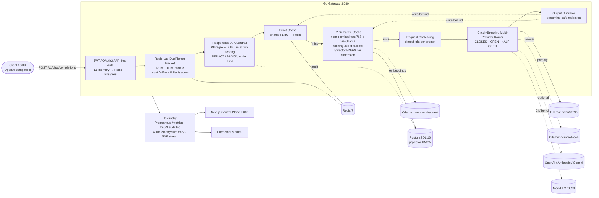

# Architecture

How a request flows through the gateway, what each component does, and why it is built this way. Back to the [README](../README.md).

### Request lifecycle

1. **Auth** (`internal/auth`): accepts `Authorization: Bearer <JWT>` signed with HS256, RS256 with a static PEM key, or RS256 from an OAuth2/OIDC **JWKS** endpoint (with key rotation by `kid`). It also accepts `X-API-Key`, looked up through **L1 memory → Redis → PostgreSQL**. Keys are stored only as SHA-256 hashes, and unknown keys are negatively cached. The JWT claims `tenant_id`, `tier`, `rpm_limit`, `tpm_limit`, and `pii_mode` define the tenant policy.
2. **Rate limit** (`internal/ratelimit`): one **atomic Lua script** refills and checks *both* buckets using the Redis server clock, and debits them only if **both** have capacity. TPM is charged with an estimate (prompt chars/4 + `max_tokens`) and **reconciled** after the response; cache hits are refunded in full. Bucket keys use `{tenant}` hash tags, so they're safe on Redis Cluster. If Redis errors, a sharded in-process bucket takes over and Redis is retried after a backoff.
3. **Guardrails** (`internal/guardrails`): PII detection uses regexes, **Luhn + IIN** validation for cards, SSN area/group/serial rules, emails, phones, AWS keys, and OpenAI/GitHub/Slack/Google API keys. Matches are redacted (`[REDACTED_SSN]`, …) or blocked (`400 PII_DETECTED`) according to the tenant's mode. The injection firewall combines 11 weighted heuristics with a noisy-OR. They run over leetspeak-folded and spaced-letter-collapsed text, plus delimiter and chat-template tokens, role spoofing, and **base64-encoded payloads**, which are decoded and re-scored. Prompts at or above 0.70 are blocked (`400 PROMPT_INJECTION`).
4. **Cache** (`internal/cache`): the **exact** key is `sha256(tenant, model, normalized conversation)`. The **semantic** lookup embeds the final user turn with `nomic-embed-text` (768-d) on local Ollama and searches pgvector, scoped by tenant, model, a **scope hash** of the system prompt and prior turns, and the **embedder** that produced the vector. If Ollama's embedder is unreachable, a deterministic hashing embedder (384-d) takes over; vectors from different embedders are never compared, and each embedder has its own calibrated threshold (0.92 for nomic, 0.86 for hashing). Writes are asynchronous (write-behind), and PII is redacted *before* anything is cached.
5. **Coalescing:** concurrent identical misses share one upstream call through `singleflight`. In tests, 25 concurrent identical requests produced exactly 1 upstream call.
6. **Router** (`internal/router`): adapters translate OpenAI ⇄ Anthropic Messages ⇄ Gemini `generateContent`, for both JSON and SSE; Ollama uses its OpenAI-compatible endpoint, with per-provider `extra_body` (for example `reasoning_effort: none`). A `5xx`, `429`, timeout, or transport error fails over to the next target; other `4xx` errors don't and never trip the breaker. Streams fail over before the first byte is relayed. Chaos drills (`X-Gateway-Chaos: fail-primary | timeout-primary`) are synthesized inside the gateway, so they work against any upstream, including local Ollama.
7. **Output guardrails:** JSON responses are redacted directly. Streams go through a holdback-window redactor that catches PII split across chunk boundaries, with tests at 1-, 3-, 7-, 16-, and 64-byte chunk sizes.

### Response headers

| Header | Meaning |
|---|---|
| `X-Gateway-Cache` | `HIT-EXACT` · `HIT-SEMANTIC` · `MISS` · `BYPASS` |
| `X-Gateway-Cache-Similarity`, `X-Gateway-Cache-Layer` | cosine score; `memory` / `redis` / `pgvector` |
| `X-Gateway-Embedder` | embedder used for the semantic lookup, e.g. `ollama:nomic-embed-text` or `hashing-ngram-384` (fallback) |
| `X-Gateway-Provider`, `X-Gateway-Upstream-Model`, `X-Gateway-Provider-Failover`, `X-Gateway-Attempts` | serving provider and model; `true` if a fallback served the request; upstream attempts |
| `X-Gateway-Overhead-Ms`, `X-Gateway-Upstream-Latency-Ms`, `X-Gateway-Total-Latency-Ms` | latency breakdown |
| `X-Gateway-Guardrail`, `X-Gateway-Guardrail-Categories` | `REDACT` / `BLOCK` / `FLAG`; e.g. `CREDIT_CARD,SSN` |
| `X-RateLimit-Limit-Requests`, `X-RateLimit-Remaining-Requests`, `X-RateLimit-Limit-Tokens`, `X-RateLimit-Remaining-Tokens`, `X-RateLimit-Reset`, `Retry-After` | standard quota headers (429 on exhaustion) |
| `X-Gateway-Tokens-Saved`, `X-Gateway-Coalesced`, `X-Request-ID` | savings, coalescing, tracing |

## Local models

`configs/gateway.yaml` (the default) runs everything on a local [Ollama](https://ollama.com) server:

| Role | Model | Notes |
|---|---|---|
| Primary chat model | `qwen3.5:9b` | provider `ollama-qwen`, OpenAI-compatible `/v1/chat/completions` |
| Fallback chat model | `gemma4:e4b` | provider `ollama-gemma`; `gemma4:12b` also works if memory allows |
| Semantic-cache embeddings | `nomic-embed-text` | `/api/embeddings`, 768 dimensions, normalized by the gateway |

**Calibration.** `nomic-embed-text` similarities live on a different scale from the hashing embedder. On paraphrase and near-miss pairs, paraphrases scored ≥ 0.948 and different questions ≤ 0.890, so the nomic threshold is **0.92** (the hashing embedder keeps 0.86). No task prefix gave the widest gap for question-to-question matching.

The gateway also exposes an OpenAI-compatible **`POST /v1/embeddings`** that serves the configured embedder, authenticated and rate-limited like chat.

## Key design decisions

- **Rate-based circuit breaking in admission order.** The breaker trips when ≥50% of the last 20 calls failed (minimum 10), and counts each result only after every earlier-admitted call has resolved, so fast failures can't masquerade as a burst. See the [changelog](../CHANGELOG.md) (0.1.0).
- **Pre-warmed connection pool and batched hit counters.** Bursts never pay connection setup in the request path, and hot cache rows aren't updated once per hit. See the [changelog](../CHANGELOG.md) (0.1.0).
- **Neural embeddings with a deterministic fallback.** The cache embeds with `nomic-embed-text` on local Ollama. If Ollama is unreachable, a dependency-free hashing embedder (signed feature hashing into 384 dimensions, about 2 µs per prompt) takes over, so the gateway never loses its cache. A *busy* Ollama is different: the request skips the semantic lookup instead of switching embedders, which would split the cache. Entries are scoped by embedder and each embedder has its own calibrated threshold. Precision is **measured**: the benchmark checks every semantic hit against the question that produced the cached answer.
- **Fail open on infrastructure, fail closed on policy.** If Redis or Postgres is down, the gateway degrades to local rate limiting and an in-memory cache and key store rather than going offline. Guardrails never fail open.
- **Overhead is measured, not estimated.** The gateway reports total time minus upstream time per request. Coalesced followers subtract their actual wait.

## Observability

**`/metrics`** (Prometheus): `llmgateway_requests_total{model,cache,code}`, `llmgateway_gateway_overhead_seconds`, `llmgateway_upstream_latency_seconds{provider}`, `llmgateway_cache_lookups_total{result}`, `llmgateway_cache_similarity`, `llmgateway_tokens_saved_total`, `llmgateway_cost_saved_usd_total`, **`llmgateway_guardrail_triggers_total{type,action}`**, `llmgateway_ratelimit_rejections_total{reason}`, `llmgateway_circuit_breaker_state{provider}`, `llmgateway_provider_failovers_total{from,to}`, `llmgateway_embedder_fallbacks_total`, and more.
- **`/v1/telemetry/summary`** and **`/v1/telemetry/stream`** (SSE, 1 s): totals, RPS, p50/p95/p99 overhead vs. upstream, exact/semantic/miss counts, USD saved, guardrail counts by category, breaker state and latency per provider, and the 50 most recent request traces.
- **Audit:** one structured JSON line per request and guardrail event. Guardrail events are also batch-`COPY`'d into the `guardrail_audit` table.

## Configuration

`configs/gateway.yaml` (local Ollama, the default) and `configs/gateway.mock.yaml` (bundled mock upstream) are both documented inline, and every value can be overridden with environment variables (`LLMGW_CONFIG`, `LLMGW_OLLAMA_URL`, `LLMGW_REDIS_ADDR`, `LLMGW_POSTGRES_DSN`, `LLMGW_JWT_SECRET`, `LLMGW_JWKS_URL`, `LLMGW_CORS_ORIGINS`, `LLMGW_MOCKLLM_URL`, …). `.env.example` lists them; the Makefile loads `.env` if present. `server.dependency_wait` (default 30s) sets how long the gateway retries Redis and PostgreSQL at startup before falling back to in-memory mode, since containers can start in any order. The production Kubernetes ConfigMap disables the dev token endpoint and chaos headers, and a test enforces this.
